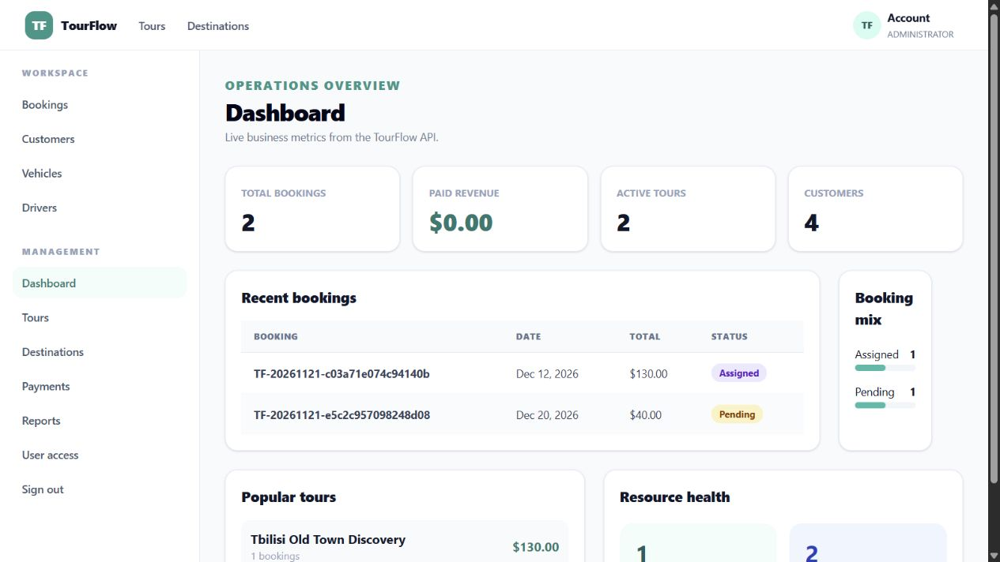
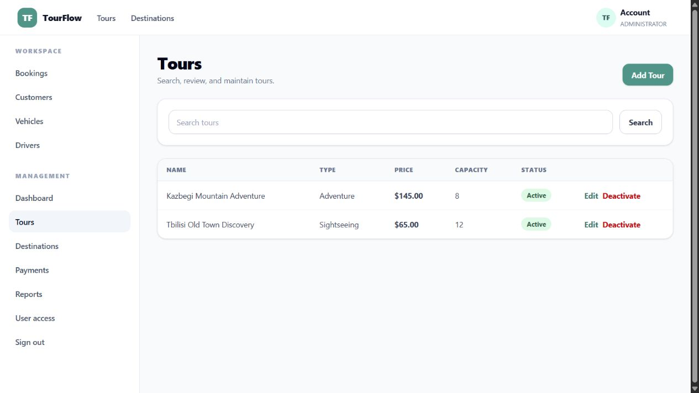
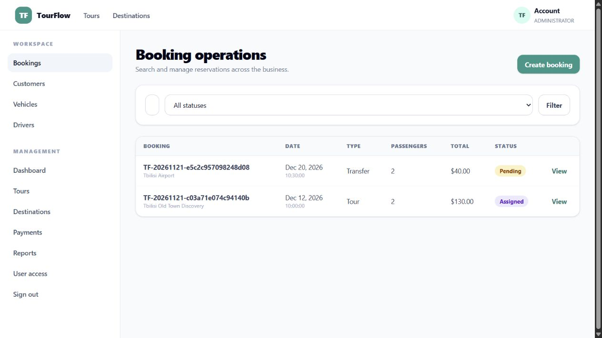

# TourFlow

TourFlow is a full-stack tour and transfer reservation platform for customers, operations teams, managers, administrators, and drivers. It combines a Clean Architecture ASP.NET Core API with a responsive Angular application and SQL Server persistence.

> Portfolio project: payments are simulated operational records. TourFlow does not process cards or connect to a payment gateway.

## Highlights

- Public destination and tour catalogue with search, filtering, sorting, and pagination
- Customer registration, profile management, tour/transfer booking, history, and cancellation
- Operations workflows for customers, bookings, statuses, vehicles, drivers, and schedules
- Manager and administrator tools for catalogue maintenance, assignments, dashboards, reports, payments, and user access
- Mobile-first driver schedule with assigned trip details and permitted status updates
- JWT authentication, rotating refresh tokens, ASP.NET Core Identity, and five server-enforced roles
- Optimistic booking concurrency and SQL Server locks for conflict-safe driver/vehicle assignment
- Consistent Problem Details responses, validation, OpenAPI, and health checks

## Screenshots

### Operations dashboard



### Tours management



### Bookings management



## Technology

| Area | Technologies |
| --- | --- |
| Backend | .NET 10, ASP.NET Core Minimal APIs, EF Core 10, MediatR, FluentValidation, Mapster |
| Frontend | Angular 22, standalone components, strict TypeScript, signals, reactive forms, Tailwind CSS 4 |
| Data | SQL Server, EF Core migrations, optimistic concurrency, relational constraints |
| Security | ASP.NET Core Identity, JWT bearer authentication, rotating hashed refresh tokens, role policies |
| Quality | xUnit, `WebApplicationFactory`, Vitest, OpenAPI, health checks, NuGet vulnerability auditing |

## Architecture

The backend follows Clean Architecture as a modular monolith:

```text
TourFlow.Domain          independent business model and invariants
        ↑
TourFlow.Application     use cases, CQRS requests, contracts, validation
        ↑
TourFlow.Infrastructure  EF Core, SQL Server, Identity, service implementations
        ↑
TourFlow.API             HTTP endpoints and composition root
```

The API never returns EF Core entities directly. Reads use database-side filtering and DTO projections; endpoints remain thin. See the [architecture overview](docs/architecture/overview.md) and [database ER diagram](docs/database/er-diagram.md).

The Angular application uses feature-based lazy routes:

```text
frontend/src/app/
├── core/       API, authentication, guards, interceptor, contracts
├── features/   public, auth, customer, operations, driver, profile
├── layout/     responsive application shell
└── shared/     errors, toasts, status badges, state pages
```

## Portals and roles

| Portal | Capabilities |
| --- | --- |
| Public | Browse active destinations and tours; register or sign in |
| Customer | Create tour/transfer bookings, view history/details, update profile, cancel eligible bookings |
| Operations | Manage bookings and customers; review vehicles, drivers, and operational status |
| Management | Maintain catalogue/resources, assign drivers and vehicles, review dashboards and reports |
| Administrator | Manage user roles and account access in addition to management features |
| Driver | View only assigned work and perform allowed start/complete actions |

Supported roles are `ADMINISTRATOR`, `MANAGER`, `OPERATOR`, `DRIVER`, and `CUSTOMER`. Angular guards improve navigation, but the API remains the authorization authority. Registration always creates a customer account.

## Booking workflow

1. A customer or staff member creates a tour or transfer booking.
2. The API validates inputs and calculates the price; clients never submit a price.
3. Operations confirms or rejects the request.
4. A manager or administrator assigns an active driver and adequately sized vehicle.
5. The assigned driver starts and completes the trip.
6. Every status transition is appended to booking history with its actor and UTC timestamp.

Booking updates return an opaque `version` value. Clients return it on subsequent writes so stale changes receive HTTP 409. Assignment writes use SQL Server transactions and application locks to prevent overlapping schedules.

## Getting started

### Prerequisites

- .NET 10 SDK
- SQL Server 2022+ (native installation or Docker Desktop)
- Node.js 26 and npm 11
- A trusted ASP.NET Core development certificate: `dotnet dev-certs https --trust`

### 1. Configure SQL Server

For Docker, copy `.env.example` to the ignored `.env` file, replace the example value with a strong local password, then run:

```powershell
docker compose up -d sqlserver
docker compose ps
```

For native SQL Server using Windows authentication:

```powershell
$env:ConnectionStrings__TourFlowDatabase = "Server=localhost;Database=TourFlow;Trusted_Connection=True;TrustServerCertificate=True"
```

For the Docker SQL Server, supply its password only through your local environment:

```powershell
$env:TOURFLOW_SQL_PASSWORD = "<your-local-password>"
$env:ConnectionStrings__TourFlowDatabase = "Server=localhost,1433;Database=TourFlow;User Id=sa;Password=$env:TOURFLOW_SQL_PASSWORD;TrustServerCertificate=True;Encrypt=False"
```

### 2. Configure authentication

Generate a base64 key of at least 32 random bytes and keep it in the current process or a local secret store:

```powershell
$env:Jwt__SigningKey = [Convert]::ToBase64String([Security.Cryptography.RandomNumberGenerator]::GetBytes(32))
```

No JWT signing key or development account password belongs in source control.

### 3. Apply migrations and run the API

```powershell
dotnet tool restore
dotnet restore TourFlow.sln
dotnet tool run dotnet-ef database update --project src/TourFlow.Infrastructure --startup-project src/TourFlow.API --context TourFlowDbContext
dotnet run --project src/TourFlow.API
```

The development API listens at `https://localhost:7081` with:

- Swagger UI: `https://localhost:7081/swagger`
- Scalar API reference: `https://localhost:7081/scalar/v1`
- OpenAPI JSON: `https://localhost:7081/openapi/v1.json`
- Health check: `https://localhost:7081/health`

To create the first development administrator, set `AuthBootstrap__Email` and `AuthBootstrap__Password` locally and run the API once with `--AuthBootstrap:Run=true`. Credentials are intentionally not included in this repository.

### 4. Run the frontend

```powershell
cd frontend
npm install
npm start
```

Open `http://localhost:4200`. The development environment targets `https://localhost:7081`; trusted local Angular origins are configured in `appsettings.Development.json`.

## Testing

```powershell
# Backend build and tests
dotnet build TourFlow.sln
dotnet test TourFlow.sln --no-build

# Frontend build, tests, and dependency audit
cd frontend
npm ci
npm run build
npm test -- --watch=false
npm audit
```

SQL-backed integration tests require `TOURFLOW_TEST_SQLSERVER` pointing to a development SQL Server where isolated test databases may be created. Do not point those tests at a production database.

## Configuration and security

- Local secrets belong in environment variables, user secrets, or the ignored `.env` file.
- `.env.example` contains an example value only.
- Refresh tokens are opaque, SHA-256 hashed at rest, rotated transactionally, and protected against family reuse.
- The current browser contract stores access and refresh tokens in tab-scoped `sessionStorage`.
- Production deployment should use HTTPS throughout and preferably move refresh tokens to secure HttpOnly cookies through a coordinated API contract change.

## Project status

Backend and Angular frontend phases are implemented. The solution includes customer, operations/administration, and driver workflows and has been verified locally against native SQL Server. Detailed milestone and test history is recorded in [PROJECT_STATUS.md](PROJECT_STATUS.md).

Current boundaries:

- Payments are simulations; there is no gateway or cardholder data.
- Transfer pricing uses a configurable base-plus-passenger formula, not distance routing.
- Scheduling supports same-day intervals without route optimization or multi-day assignments.
- Reports are live aggregates without exports or accounting/tax reconciliation.
- Password reset has a provider abstraction, but email delivery is not configured.

## Repository metadata

Suggested description:

> Full-stack tour and transfer reservation platform built with ASP.NET Core, Angular and SQL Server.

Suggested topics: `aspnetcore`, `dotnet`, `angular`, `typescript`, `sql-server`, `clean-architecture`, `booking-system`, `reservation-system`, `fullstack`, `portfolio`.

No license is currently included. MIT is a suitable choice for an open portfolio project, but a license should only be added after the repository owner approves it.
