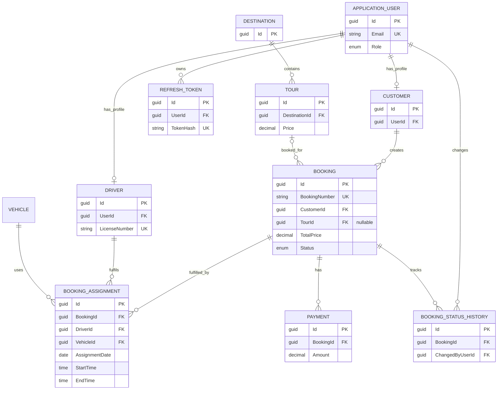

# Domain database design

This diagram reflects the Milestone 2 domain model. EF Core mappings, indexes, delete behavior, migrations, and database constraints will be implemented in Milestone 3.

## Design decisions for Milestone 3

- All primary keys are generated `Guid` values. Every entity inherits UTC `CreatedAt`; mutable entities also retain `UpdatedAt`.
- `Booking.TourId` is nullable only for `Transfer` bookings. A `Tour` booking requires a tour at the domain level.
- Required unique constraints: `ApplicationUser.Email`, `Customer.UserId`, `Driver.UserId`, `Driver.LicenseNumber`, `Vehicle.RegistrationNumber`, `Booking.BookingNumber`, and `RefreshToken.TokenHash`.
- Required operational indexes include booking lookups by customer/date/status and assignment lookups by driver/date/time and vehicle/date/time. These indexes support the later overlap checks but cannot alone enforce interval overlap prevention.
- Deleting a booking should cascade only to its status history, payments, and assignments. Customers, tours, drivers, vehicles, destinations, and users must be protected from deletion while operational records reference them.
- Monetary values (`Tour.Price`, `Booking.TotalPrice`, and `Payment.Amount`) will use SQL Server `decimal(18,2)`. Timestamps are stored as UTC; `DateOnly` and `TimeOnly` represent business schedules.
