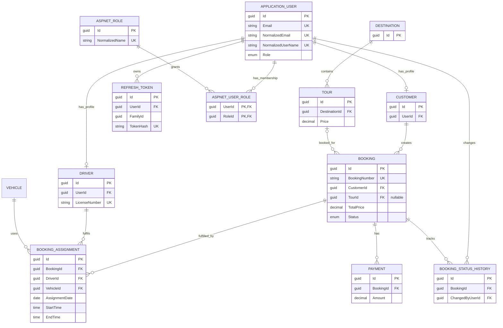

# Domain database design

The operational schema uses `InitialCreate` and `ProtectBookingRecords`. `AddIdentityAuthentication` extends the same user table with Identity and adds role membership and refresh-token family tracking. Demo data runs through opt-in Development seeding.

## Implemented database design

- All primary keys are application-generated `Guid` values. Every entity inherits UTC `CreatedAt`; mutable entities also retain `UpdatedAt`. EF Core converters restore `DateTimeKind.Utc` when SQL Server `datetime2` values are read.
- `Booking.TourId` is nullable only for `Transfer` bookings. A `Tour` booking requires a tour at the domain level.
- Unique constraints are implemented for `ApplicationUser.Email`, `Customer.UserId`, `Driver.UserId`, `Driver.LicenseNumber`, `Vehicle.RegistrationNumber`, `Booking.BookingNumber`, `Payment.TransactionReference` when present, and `RefreshToken.TokenHash`.
- Operational indexes are implemented for active tour/destination filters, customer booking history, booking date/status, and driver/vehicle assignment schedules. The scheduling indexes support overlap queries; interval-overlap enforcement remains an application/database transaction concern for a later operational milestone.
- Booking status history, payment and assignment foreign keys prevent deletion of referenced bookings. Customers, tours, drivers, vehicles, destinations, users, and status-change actors are also protected from deletion while operational records reference them.
- Monetary values (`Tour.Price`, `Booking.TotalPrice`, and `Payment.Amount`) use SQL Server `decimal(18,2)`. `DateOnly` and `TimeOnly` are stored as `date` and `time(0)`; tour duration is stored as ticks in `bigint` to avoid SQL Server's 24-hour `time` limit.
- Private materialization constructors support EF Core. Public constructors retain domain validation. `ApplicationUser` derives from the lightweight Identity user model so profile relationships and Identity credentials share the same user key.
- The refresh-token table indexes hashed tokens and user/session families. SQL Server transaction-owned per-user locks serialize token rotation and revocation.
